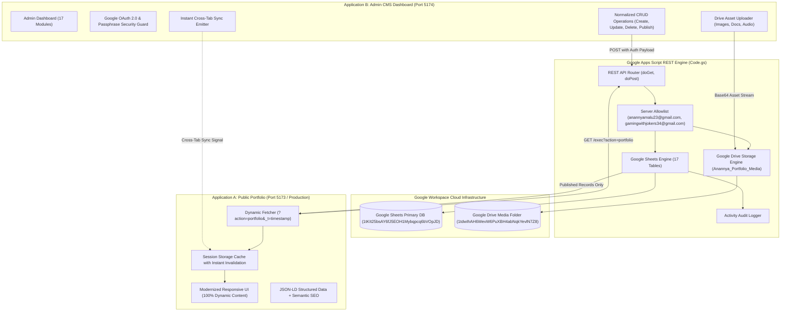

# ANANNYA AK — COMPLETE PORTFOLIO CMS & ARCHITECTURE

Production-grade Content Management System (CMS) and Personal Portfolio website architecture for **[https://anannya-ak.onrender.com](https://anannya-ak.onrender.com)**.

This repository contains two independent frontends sharing a synchronized Google Sheets database and Google Apps Script serverless backend with Google Drive asset storage:
1. **Public Portfolio Website (`src/`)**: A high-performance, dynamic portfolio built with React 18, TypeScript, Tailwind CSS, Motion, and Kokonut UI.
2. **Administration Dashboard (`admin/`)**: A secure, modern CMS control panel with 17 management modules, live previews, and audit logging.
3. **Serverless REST Backend (`backend/Code.gs`)**: Google Apps Script connecting to a 17-sheet relational database in Google Sheets.

---

## 1. System Architecture & Data Flow



---

## 2. Root Cause Analysis: Why Admin Changes Failed to Reflect Previously

During our comprehensive audit, five distinct points of failure were identified and resolved:

1. **Silent Fallback to LocalStorage (Fake Success in Admin)**: In `admin/src/services/api.ts`, whenever an API request failed, the client silently caught the exception and executed a local fallback that modified `localStorage`. The admin UI displayed a false "Saved to database" toast notification, while Google Sheets was never touched.
   - *Fix:* Removed the silent fake fallback for all mutations. All operations now communicate with Google Sheets and display real errors if anything fails.
2. **Aggressive Browser & Session Caching**: The public portfolio previously cached responses without timestamp query parameters (`_t`), causing browsers to serve stale data.
   - *Fix:* Added dynamic timestamp query parameters (`?action=portfolio&_t=${Date.now()}`) and cross-tab storage event listeners to trigger immediate re-fetching.
3. **Missing Modules in Apps Script Schemas**: `backend/Code.gs` lacked schema definitions for `Services`, `Testimonials`, `Resume`, and `SEOSettings`.
   - *Fix:* Extended `backend/Code.gs` and `setupDatabase()` to non-destructively manage all 17 tables.
4. **Hardcoded Fallbacks Masking Real Database Content**: Dynamic project visualizers previously used hardcoded switches for 6 initial project slugs.
   - *Fix:* Replaced with flexible, category-driven visualizers and thumbnail image rendering.
5. **Apps Script Web App Versioning**: Editing Apps Script code does not update the active deployment unless a **New Version** is explicitly deployed under Deploy > Manage deployments.

---

## 3. Google Account & Database Configuration

- **Google Drive & Spreadsheet Owner Account:** `anannyamalu23@gmail.com`
- **Google Apps Script Deployment Account:** `gamingwithjokers34@gmail.com`
- **Connected Spreadsheet ID:** `1tKIt25bsAY6fJ5EOH1Mybqpcq6bVOpJD`
- **Connected Google Drive Media Folder ID:** `1tdwIhAH6WevW6PuXBH4abNqkYevlN7Z8`
- **Authorized Administrators:**
  - `anannyamalu23@gmail.com`
  - `gamingwithjokers34@gmail.com`
  - `anannyaak01@gmail.com`

---

## 4. Required Apps Script Deployment Steps

1. Open your Apps Script Project at [script.google.com](https://script.google.com) signed in as `gamingwithjokers34@gmail.com` (or access via the Google Sheet: *Extensions > Apps Script*).
2. Ensure the Google Sheet is shared with `gamingwithjokers34@gmail.com` as **Editor**.
3. In the left file tree, click `Code.gs`. Replace all contents with [`backend/Code.gs`](./backend/Code.gs).
4. Save the project (`Ctrl+S` / `Cmd+S`).
5. In the top function dropdown, select **`setupDatabase`** and click **Run** to non-destructively verify all 17 sheets.
6. Click **Deploy > Manage deployments**:
   - Select your active Web App deployment.
   - Click the **pencil icon (Edit)** at top right.
   - Under **Version**, click the dropdown and choose **New version**.
   - Ensure:
     - **Execute as:** `Me (gamingwithjokers34@gmail.com)`
     - **Who has access:** `Anyone`
   - Click **Deploy**.
7. Copy your Web App URL and update `VITE_APPS_SCRIPT_URL` in `.env` and `admin/.env`.

---

## 5. Administration Modules (17 Core Sections)

1. **Dashboard Overview**: System metrics, published vs draft content, database connection status, API health, last sync time, audit trail.
2. **Profile Management**: Name, headline, designation, bio, avatar URL, CGPA, specialization, and availability status.
3. **About Section**: Professional narrative, computational interests, and institutional profile.
4. **Skills Management**: Skill name, proficiency (0–100%), category, icon, display order, and publication status.
5. **Experience Management**: Role, company, employment type, start/end dates, responsibilities bullets, and tech stack tags.
6. **Education Management**: Institution, degree, field of study, period, CGPA/grade, and course description.
7. **Projects Management**: Showcase engineering projects, GitHub repositories, live demo URLs, tech badges, and visual styles.
8. **Certifications**: Verified credentials from IIT Bombay, NPTEL, issue dates, and verification links.
9. **Achievements**: Academic honors, awards, and event recognitions.
10. **Services**: Data engineering, machine learning pipelines, and full-stack web capabilities with key deliverables.
11. **Testimonials**: Mentor recommendations, academic supervisor quotes, and star ratings.
12. **Resume Management**: Active CV document linking, Google Drive PDF upload, and download tracking.
13. **Social Media Links**: GitHub, LinkedIn, email, and social networks with icons.
14. **Contact Channels**: Transmission parameters, email routing, and direct copy-to-clipboard.
15. **SEO & GEO Optimization**: Page titles, meta descriptions, canonical URLs, social share preview cards, and indexing status.
16. **Website Settings**: Theme mode, emerald/mint color accents, section visibility toggles, and animation controls.
17. **Media Management**: Google Drive cloud asset library for images, PDF documents, and audio tracks.

---

## 6. Technical SEO & GEO (Generative Engine Optimization)

- **XML Sitemap**: Valid XML sitemap accessible at `/sitemap.xml` with canonical production URLs.
- **Robots.txt**: Formatted `/robots.txt` disallowing private admin routes (`/admin`) and referencing `/sitemap.xml`.
- **JSON-LD Structured Data**: Five semantic graph schemas embedded in `<head>`:
  - `Person`: Identity, job title, institutional affiliation, skills, sameAs verified links.
  - `WebSite`: Publisher identity and primary domain.
  - `ProfilePage`: Canonical portfolio page representation.
  - `BreadcrumbList`: Navigation hierarchy for search engines.
  - `ItemList`: Verified engineering projects catalog.

---

## 7. Local Development & Production Commands

### Running Public Portfolio (Port 5173)
```bash
npm install
npm run dev
```

### Running Admin CMS Dashboard (Port 5174)
```bash
cd admin
npm install
npm run dev
```

### Building for Production
```bash
# Build public portfolio
npm run build

# Build admin CMS
cd admin && npm run build
```
